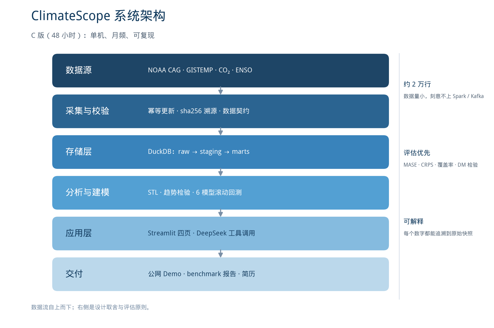

# CLMTA → ClimateScope 项目落地方案

> 面向「数据 + AI」方向的本科就业 · 双非院校的差异化打法
> 版本 v3｜2026-10-19｜适用：昆明理工大学 数据科学与大数据技术 大二

## 0. 结论先行

### 0.1 数据已经更新到最新

已从 NOAA 官方接口重新拉取并替换 `data/data.csv`：

| 项目 | 更新前 | 更新后 |
| --- | --- | --- |
| 时间范围 | 1850-01 ~ 2024-12 | **1850-01 ~ 2026-09** |
| 记录数 | 2100 | **2121** |
| 序列数 | 1（全球陆海） | **3（陆海 / 陆地 / 海洋）** |
| 溯源信息 | 无 | sha256 + 抓取时间 + 原始快照 |

关键数字：2025 年均值 **1.12 °C**，2026 年 1–9 月均值 **1.17 °C**，2026-09 为 **1.33 °C**；1970 年以来升温速率约 **0.196 °C/十年**；有记录以来最暖月份仍是 2023-09（1.40 °C）。

**为什么要用最新数据**：面试时说「我的管道每月自动更新到上个月」和「CSV 是网盘下载的」，可信度差一个量级。而且 2025–2026 刚好经历 ENSO 相位变化，是天然的分析素材。

### 0.2 哪一版更适合你的简历：C 版

| 维度 | A 版（48 h MVP） | B 版（10 周全量） | **C 版（v2.5，推荐）** |
| --- | --- | --- | --- |
| 范围 | 管道 + 分析 + 6 模型回测 + Demo | 再加 DL 训练、完整 RAG、MLflow、MCP | A + 3 个高杠杆增强 |
| 48 h 内完成概率 | 高 | 低 | 高 |
| 简历深度 | 中 | 高（如果做完） | 中高 |
| 面试可讲点 | 3 个 | 6 个 | 5 个 |
| 最大风险 | 偏薄 | 做不完、讲不清 | 需要严格执行周计划 |
| 适合 | 只想先有一个项目 | 有 10 周完整时间 | **你的情况** |

**结论：选 C 版。** 双非本科简历的第一关不是「模型多先进」，而是「这个人能不能干活、有没有工程习惯」。一个 48 小时做完、能上线、每个数字都能解释的项目，远胜一个 10 周做了一半的「平台」。

C 版在 A 的基础上只加三件事：

1. **业务指标层 + 20 条 SQL**：把分析问题写成可讲清的 SQL（窗口函数、同比、滚动），中厂数据岗面试直接考这个。
2. **英文 README + 一页英文 Project Brief**：外企筛简历和面试都要看，成本只有 2 小时。
3. **公网 Demo + 2 分钟演示视频**：所有公司都吃这一套，面试时直接发链接。

### 0.3 双非 + 昆明，怎么打

一句话：**主攻数据开发 / 数据分析 / BI，用 AI 应用做差异化，算法岗只作为加分项。**

- 本科 + 双非投大厂算法岗，简历关就很容易被硕士挤掉；但数据开发、数据分析、BI、数据工程对本科友好得多。
- 昆明本地数据岗少，主战场是成都、重庆、西安、武汉、深圳、杭州、上海；云南本地国企和银行科技做保底。
- 外企不唯学历，但英语和项目深度要求高；英文材料 + 可复现仓库是敲门砖。
- 你现在大二，距离 2028 年秋招还有约两年，足够做 3 个项目 + 2 段实习，不必焦虑。

## 1. 数据更新说明

### 1.1 已完成的变更

| 文件 | 说明 |
| --- | --- |
| `data/data.csv` | 主序列，已更新为 1850-01 ~ 2026-09 |
| `data/raw/` | 3 条序列的原始快照 + 2024 年旧快照（只增不删） |
| `data/metadata.json` | 每个文件的来源 URL、sha256、行数、时间范围、基准期 |
| `scripts/update_data.py` | 纯标准库实现，一条命令复现更新 |

设计要点：原始字节保留、不做二次加工；更新前先校验（表头、月份连续、值域、缺失标记），校验不过不覆盖；旧版本自动归档。这就是简历里可以写的「幂等增量更新 + 数据契约」。

### 1.2 怎么复现

```bash
python scripts/update_data.py            # 拉取最新并校验
python scripts/update_data.py --dry-run  # 只校验，不写文件
```

脚本不依赖 pandas，环境坏了也能跑；后续进入项目阶段会迁移到 `src/clmta/ingest/`，并加上 DuckDB 落库。

### 1.3 新数据能讲的故事

- 2023-09（1.40 °C）仍是 1850 年以来最暖月份，2024 年全年 1.25 °C。
- 2025 年回落到 1.12 °C，2026 年 1–9 月又回到 1.17 °C——这个「回落再反弹」可以用来检验 ENSO 与全球温度的关系。
- 陆地升温明显快于海洋：2025 年陆地 1.74 °C、海洋 0.83 °C；2026 年 1–9 月陆地 1.63 °C、海洋 0.96 °C。
- 2020 年代均值 1.06 °C，而 1850 年代是 −0.10 °C。

### 1.4 使用注意

- 温度异常是相对 1901–2000 基准期的偏差，不是绝对温度。
- 1880 年以前海洋观测稀疏，早期数据不确定性更大，图表和结论必须标注。
- 2026 年只有 1–9 月，做年度对比时不能直接和完整年份比。
- 官方会回改历史值，所以每次更新都要保留快照并对比差异。

## 2. 三版方案对比与最终范围

### 2.1 为什么不是 B 版

B 版的深度学习训练（N-HiTS/PatchTST）需要 GPU 和调参时间，完整 RAG 需要语料清洗和评测，MLflow/MCP 是锦上添花。以每周 8 小时、12 月还要期末复习的节奏，B 版大概率停在「数据管道 + 一个 notebook」，反而不如 A/C 完整。

### 2.2 C 版做什么、不做什么

| 做 | 不做（寒假再说） |
| --- | --- |
| 多源数据管道 + 校验 + DuckDB | Kafka / Spark / 微服务 |
| STL / 趋势检验 / 变点 / 极值 | 深度学习训练 |
| 6 个模型滚动回测 + 显著性检验 | 完整 RAG 知识库 |
| Streamlit 四页 + 公网部署 | MLflow / Docker Compose |
| DeepSeek 工具调用 + 10 题评测 | MCP Server |
| 20 条 SQL + 英文 README + 视频 | 论文复现 |

## 3. 就业策略：双非、昆明、中厂与外企

### 3.1 三个必须接受的现实

1. **学历筛选客观存在。** 大厂算法岗、部分管培生项目会卡学校；但数据开发、数据分析、BI、测试开发、外企 IT 岗对双非本科开放得多。
2. **昆明本地数据岗少。** 云南的互联网岗位集中在少数国企和银行科技，想拿高薪大概率要去成都、重庆、西安、深圳、杭州、上海。
3. **实习比项目更硬。** 双非本科最有效的翻身路径是「一段能讲清楚的实习 + 一个能跑的项目」，而不是堆证书。

### 3.2 岗位地图

| 岗位 | 本科可行性 | JD 高频词 | 本项目对应模块 |
| --- | --- | --- | --- |
| 数据分析师 | 高 | SQL、Excel、指标体系、可视化、业务分析 | 分析层 + 20 条 SQL + Streamlit |
| 数据开发 / 数据工程 | 高 | SQL、Python、数仓分层、调度、数据质量 | 数据管道 + DuckDB + 契约校验 |
| BI / 数据产品 | 中高 | 报表、指标口径、FineBI/Tableau、沟通 | 看板 + 指标层 |
| AI 应用 / LLM 工程 | 中 | RAG、Agent、Prompt、评测、API | Agent + 评测 |
| 算法（时序/ML） | 低（多要求硕士） | 特征工程、模型评估、Python | 回测框架 + 模型对比（加分） |

> 结论：把「数据开发 + 分析」当主线，「AI 应用」当差异化，「算法」当面试聊天时的加分项。

### 3.3 目标公司分层

| 层级 | 类型 | 代表（示例，投递前以当年校招为准） | 说明 |
| --- | --- | --- | --- |
| 冲刺 | 外企 / 合资 | SAP、IBM、Accenture、ThoughtWorks、HSBC、Standard Chartered、Dell、Ericsson、Nokia、Schneider、Bosch | 不唯学历，重英语、基础、行为面试；数据岗 headcount 少，要早投 |
| 主攻 | 中厂数据 / BI | 神策、观远、帆软、永洪、星环、Kyligence、涛思、数澜、袋鼠云、明略、百分点、易观 | 看项目匹配和 SQL，本科有机会 |
| 主攻 | 金融科技子公司 | 招银网络、中电金信、宇信、长亮、神州信息、恒生电子、同花顺 | 双非友好，待遇中上，加班看部门 |
| 主攻 | 成都 / 重庆 / 西安本地中厂 | 数之联、科来、长安汽车数字化、中兴、比亚迪等 | 离云南近，生活成本低，校招量大 |
| 保底 | 云南本地国企 / 银行 | 南方电网云南、云南中烟、富滇银行、运营商云南分公司、南天信息、云南能投 | 稳定、本地校友多；多数要笔试，提前准备 |
| 谨慎 | 外包 | 中软国际、软通动力等 | 保底可以，成长和薪资上限有限，优先选有自研产品的团队 |

> 提醒：外企的「数据岗」很多叫 Data Analyst / Business Analyst / IT Trainee，分布在共享服务中心，不一定在昆明；投递时按城市筛。

### 3.4 城市选择

- **成都**：离昆明最近、中厂多、生活成本可控，第一优先。
- **重庆 / 西安 / 武汉**：校招量大，竞争比北上深小。
- **深圳 / 杭州 / 上海**：机会最多，但生活成本和竞争也最高，适合冲刺。
- **昆明**：国企、银行、运营商为主，适合保底和积累第一段实习。

### 3.5 时间线（2026–2029）

| 时间 | 阶段 | 目标 | 关键动作 |
| --- | --- | --- | --- |
| 2026.10–11 | 大二上 | 项目 1（本项目） | 完成 C 版，上线 Demo |
| 2026.12 | 期末 | 不排项目 | 复习，保持代码手感 |
| 2027.1–2 | 寒假 | 项目 1 v2 + 基础 | 补 RAG、MLflow；开始 SQL 每日一题 |
| 2027.3–6 | 大二下 | 项目 2 + 日常实习 | 业务数据 + LLM 应用；投成都/昆明日常实习 |
| 2027.7–8 | 大二暑假 | 第一段实习 | 优先数据开发/分析，哪怕公司小 |
| 2027.9–12 | 大三上 | 项目 3 / 深化 | 补算法与八股，准备暑期实习简历 |
| 2028.1–4 | 大三下 | **暑期实习投递** | 最关键窗口，海投 + 内推 |
| 2028.7–8 | 大三暑假 | 暑期实习 | 争取转正 |
| 2028.9–11 | 大四上 | 秋招 | 主攻 + 保底一起投 |
| 2029.6 | 毕业 | 入职 | — |

### 3.6 简历与英语

- 简历一页，最多两个项目 + 一段实习；项目放前面，课程放后面。
- 每条 bullet 结构：**动作 + 技术 + 量化结果**，不要写「负责」「参与」。
- 双非不写学校排名；GPA 或专业排名好看就写，不好看就省略。
- 外企准备：一页英文简历、2 分钟英文项目自述、STAR 行为面试故事各 3 个。
- GitHub 主页置顶项目，README 首屏放架构图、benchmark 表、Demo 链接。

## 4. 项目定位：调研结论

### 4.1 GitHub 同类项目分四类

| 类别 | 代表 | 规模 | 不足 |
| --- | --- | --- | --- |
| 同题学生项目 | manthankapadia、SimoAntikainen、Akajiaku11 | ★0–100 | 单 CSV + ARIMA + 一张图，无评估、无部署 |
| 通用时序库 | darts、sktime、statsforecast、Chronos、TimesFM | ★1k–35k | 只做 fit/predict，不管领域数据和解释 |
| 气候科研 benchmark | ClimateLearn、WeatherBench2、earth2studio | ★0.3k–1.2k | 面向网格气象场，要 ERA5/CMIP + GPU |
| LLM 数据分析 | Vanna、DB-GPT、WrenAI、SQLBot | ★7k–24k | 架构重、偏通用、领域评测弱 |

> star 数为 2026-10-19 快照。

### 4.2 空白点

面向「月度全球气候指标」的**可复现数据管道 + 诚实预测基准 + 能对话的分析助手 + 公网 Demo**，几乎没人同时做。

### 4.3 三个卖点

1. **数据可信**：官方接口 + sha256 + 幂等更新，不是网盘 CSV。
2. **评估诚实**：滚动回测、MASE/CRPS/覆盖率、DM 检验；模型没赢就写没赢。
3. **能对话**：DeepSeek 工具调用 + 小评测集，回答必须带数据来源。

## 5. 系统架构与技术选型



### 5.1 五层架构

| 层 | 组件 | 产出 |
| --- | --- | --- |
| 采集层 | NOAA CAG、GISTEMP、CO₂、ONI 适配器 | 原始快照 + metadata |
| 存储层 | DuckDB（raw / staging / marts）+ Parquet | 可查询的数据集 |
| 分析层 | STL、Mann-Kendall、Theil-Sen、变点、极值 | 图表 + 结论 |
| 建模层 | 6 个模型 + 滚动回测 + 指标 + DM 检验 | benchmark 报告 |
| 应用层 | Streamlit 四页 + DeepSeek Agent + 公网部署 | Demo URL |

数据流：数据源 → 采集校验 → DuckDB → 分析/建模 → Streamlit / Agent → 用户。

### 5.2 技术选型

| 层 | 选型 | 理由 |
| --- | --- | --- |
| 语言 / 环境 | Python 3.12 + uv | 快、lock 可复现 |
| 数据处理 | pandas + DuckDB + Parquet | 2 万行足够；SQL 能力可写简历 |
| 统计 | statsmodels + scipy + ruptures | STL / SARIMAX / MK 检验 / 变点 |
| ML | LightGBM | 小数据强、CPU 秒级 |
| 基础模型 | Chronos-Bolt small | 零样本、CPU 可跑、2026 热点 |
| 前端 | Streamlit + Plotly | 两天出可交互 Demo |
| LLM | DeepSeek API | 中文强、便宜、OpenAI 兼容 |
| 测试 | pytest + ruff + GitHub Actions | 最低成本工程信号 |
| 部署 | 魔搭创空间 / HuggingFace Spaces | 免费公网 URL |

**明确不做**：Kafka、Spark、Flink、K8s、LangChain 黑盒封装、微服务拆分。数据量 2 万行，上了就是减分项，面试被问要能答出「吞吐、延迟、团队规模」三条理由。

## 6. 数据方案

### 6.1 数据源

| 数据 | 来源 | 频率 / 范围 | 用途 |
| --- | --- | --- | --- |
| 全球陆海异常 | NOAA CAG | 月，1850–2026-09 | 主目标 |
| 全球陆地 / 海洋 | NOAA CAG | 月，1850–2026-09 | 多序列对比 |
| 半球 / 纬度带 | NASA GISTEMP v4 | 月 / 年，1880– | 空间差异 |
| CO₂ | NOAA GML Mauna Loa | 月，1958– | 协变量 |
| ENSO | NOAA CPC ONI | 季，1950– | 协变量 |
| 太阳黑子 | SILSO | 月，1700– | 弱协变量 |

### 6.2 表设计

| 表 | 关键字段 | 说明 |
| --- | --- | --- |
| series | series_id、name、region、source、units、base_period | 序列元数据 |
| observation | series_id、date、value、is_missing、flag | 月度观测 |
| forecast_run | run_id、model、horizon、cutoff、params、git_sha | 一次回测 |
| forecast | run_id、date、yhat、lo80、hi80、lo95、hi95 | 预测与区间 |
| metrics | run_id、series_id、horizon、mase、rmse、crps、cov80 | 评估结果 |

### 6.3 数据质量

- 表头、类型、单位、基准期契约。
- 日期唯一且连续；值域检查；缺失标记检查。
- 官方修订导致的历史值变化：保留快照 + 生成 diff 报告。
- 每次更新输出 `data/quality_report.json`，不合格则中断。

### 6.4 更新节奏

NOAA 每月中旬发布上月数据。用 GitHub Actions 每月定时跑一次 `scripts/update_data.py`，失败发通知；本地也可以手动跑。

## 7. 分析与建模方案

### 7.1 分析层

- STL 分解（趋势 / 季节 / 残差）。
- 年度、十年、滚动 12 月均值。
- Mann-Kendall 趋势检验 + Theil-Sen 斜率与置信区间。
- 变点检测（ruptures），定位升温加速的年份。
- 极值分析：最暖 / 最冷月份、连续暖月长度。
- 海陆对比、南北半球对比、季节差异。

### 7.2 模型阶梯

| 层级 | 模型 | 作用 |
| --- | --- | --- |
| L0 | Seasonal Naive、Drift | 必须打赢的下限 |
| L1 | ETS 或 SARIMA | 经典统计基线 |
| L2 | SARIMAX-X（CO₂ / ENSO） | 可解释主力 |
| L3 | LightGBM（lag + rolling + Fourier + 协变量） | 表格 ML |
| L4 | Chronos-Bolt 零样本 | 基础模型对照 |

### 7.3 评估协议

- 任务：预测月度温度异常，horizon 取 1、3、6、12、24。
- 切分：滚动 origin（walk-forward），至少 20 个 cutoff，禁止随机切分。
- 主指标：MASE(12)；辅助：RMSE、MAE。
- 区间：CRPS、Winkler、80% / 95% 覆盖率。
- 显著性：Diebold-Mariano 检验。
- 消融：有无协变量、lookback 长度、训练窗长。
- 防泄漏：标准化只用训练段、特征 shift 正确、超参不在测试段选。

### 7.4 预期结论形态

h ≤ 3 时 ENSO 主导，LightGBM / SARIMAX-X 可能领先；h ≥ 12 时趋势和 CO₂ 主导，复杂模型优势消失；Chronos 零样本有竞争力但区间可能偏窄，覆盖率不足。**如果深度学习没赢，就写没赢，并解释原因——这比编数字更能打动面试官。**

## 8. LLM 分析助手

### 8.1 工具设计

| 工具 | 输入 | 输出 |
| --- | --- | --- |
| query_range | series_id、start、end | 月度序列 |
| compute_trend | series_id、start、end | 斜率 + 置信区间 + MK p 值 |
| forecast | series_id、horizon、model | 预测值 + 区间 |
| compare_periods | series_id、period_a、period_b | 差值 + 显著性 |
| search_documents | query | 报告片段 + 引用（寒假） |

### 8.2 实现要点

- 手写 tool-calling loop（约 100 行），不用 LangChain 黑盒。
- DeepSeek API：temperature=0、JSON Schema 校验、最多 5 步、超时重试。
- 回答必须带数据来源、基准期、月份；查不到就明确说查不到。
- 缓存 LLM 响应，30 元预算足够演示和评测。

### 8.3 评测

10 题 gold set：事实查询、趋势判断、预测、跨期对比、越界拒答。统计工具选择准确率、答案正确率、拒答正确率、平均步数与延迟。

## 9. 六周执行表

每周 8 小时，含约 1.5 小时学习。

| 周 | 主题 | 关键任务 | 周末产出 | 你要理解 |
| --- | --- | --- | --- | --- |
| 1 | 地基 + 数据管道 | 修环境、迁移采集脚本、DuckDB 建库、数据契约、README | `make data` 可复现；测试通过 | 为什么要 raw/staging/marts |
| 2 | 统计分析 + SQL | STL、趋势检验、变点、极值；20 条 SQL | 6 张图 + 3 条结论 + sql/ 目录 | MASE 之外，趋势怎么检验 |
| 3 | 回测 + 统计基线 | 回测引擎、Naive/ETS/SARIMAX-X、指标 | benchmark 表 v1 | 滚动 origin 为什么防泄漏 |
| 4 | LightGBM + Chronos | 特征工程、GBDT、零样本、汇总 | 6 模型完整对比 | 零样本模型在做什么 |
| 5 | Streamlit + 部署 | 四页应用、公网部署、英文 README | 公网 URL + 英文 brief | 前端如何读 DuckDB |
| 6 | Agent + 包装 | DeepSeek 工具调用、10 题评测、视频 | 聊天页 + 评测表 + 简历 | function calling 的消息结构 |

### 9.1 如果掉队怎么砍

- 第 3 周没完成：砍 ETS，只留 Naive 和 SARIMAX-X。
- 第 4 周没完成：砍 Chronos，保留 LightGBM，把「基础模型对比」挪到寒假。
- 第 5 周没完成：部署只做 Streamlit Community Cloud，英文 brief 用模板。
- 第 6 周没完成：砍 Agent，把 20 条 SQL 和 benchmark 报告做深——数据分析岗同样买账。

## 10. 交付物、简历与面试

### 10.1 三类硬交付

1. 公网 Demo：Streamlit 四页 + 聊天页。
2. 可复现仓库：README 首屏含架构图、benchmark 表、Quickstart、GIF、数据来源。
3. benchmark 报告 + 2 分钟视频 + 一页英文 Project Brief。

### 10.2 中文简历 bullet（数字待实测）

> **ClimateScope｜全球气候异常分析与预测平台**（个人项目，2026.10–2026.11）
> - 基于 NOAA / GISTEMP / CO₂ / ENSO 构建月度气候数据管道（1850–2026，3 条序列），实现幂等增量更新、sha256 溯源与 10 项数据契约校验，数据准备从手工 2 小时降为一条命令；
> - 设计 rolling-origin 回测框架，对比 6 个模型（Naive / ETS / SARIMAX-X / LightGBM / Chronos 零样本），以 MASE / CRPS / 区间覆盖率评估，SARIMAX-X 在 h=12 上较基线降低 X%；
> - 用 DeepSeek function calling 实现气候问答助手（3 个只读工具），10 题评测集工具准确率 X%、拒答正确率 Y%；Streamlit 部署公网可访问。

### 10.3 英文简历 bullet（外企用）

> **ClimateScope — Global Climate Anomaly Analytics & Forecasting** (Personal Project, Oct–Nov 2026)
> - Built a reproducible monthly climate data pipeline (NOAA / GISTEMP / CO₂ / ENSO, 1850–2026, 3 series) with idempotent incremental updates, SHA-256 provenance and 10 data-contract checks; cut data preparation from 2 hours to one command.
> - Designed a rolling-origin backtesting framework comparing 6 models (Seasonal Naive, ETS, SARIMAX-X, LightGBM, zero-shot Chronos) with MASE, CRPS and prediction-interval coverage; SARIMAX-X reduced MASE by X% at h=12.
> - Shipped a DeepSeek function-calling assistant (3 read-only tools) evaluated on a 10-question gold set (tool accuracy X%, refusal accuracy Y%); deployed the Streamlit demo publicly.

### 10.4 面试 10 问与答题要点

1. **2100 个点为什么值得做预测？** 预测不是目的，展示评估协议和不确定性量化才是；同时用多序列和协变量让对比有意义。
2. **怎么保证没有数据泄漏？** 滚动 origin、训练段内标准化、特征只用到 t 时刻、超参不在测试段选。
3. **为什么用 MASE 而不是 MAPE / R²？** 温度异常接近 0，MAPE 会爆炸；MASE 可与季节性朴素基线比较，跨序列可读。
4. **非平稳怎么处理？** 差分、去趋势、加协变量三种方案做消融，用回测结果说话。
5. **预测区间怎么来？** 残差 bootstrap / 分位数模型 / conformal，报告覆盖率而不是只画区间。
6. **Chronos 零样本为什么有效？** 大规模多领域预训练学到通用时序模式；但要讨论预训练语料是否覆盖测试期。
7. **Agent 怎么防幻觉？** 工具只读、JSON Schema、回答必须带来源、查不到就拒答、10 题评测。
8. **数据更新后模型怎么办？** 每月重跑回测，监控 MASE 与漂移，模型注册表记录版本。
9. **为什么不用 Kafka / Spark？** 数据量 2 万行、月频更新，单机 DuckDB 足够；引入分布式只增加运维成本。
10. **这个项目最难的地方？** 诚实评估（模型没赢）和数据质量（历史修订、早期观测稀疏）。

### 10.5 英文自述模板（2 分钟）

> I built ClimateScope, an end-to-end climate analytics project. I ingest monthly temperature anomalies from NOAA, validate them with data contracts, and store them in DuckDB. I compare statistical, machine-learning and zero-shot foundation models with a rolling-origin backtest, and report MASE, CRPS and interval coverage. I also built a small LLM assistant that answers questions by calling read-only tools, evaluated on a gold set. The hardest part was avoiding data leakage and being honest when deep learning did not beat a simple baseline.

## 11. 风险与取舍

| 风险 | 应对 |
| --- | --- |
| 每周只有 8 小时 | 只承诺周末产出；掉队按 9.1 砍功能 |
| 没有 GPU | 不训练深度模型；Chronos-Bolt small 在 CPU 上跑 |
| 30 元 API 超支 | 缓存响应、限制评测次数、只在演示时调用 |
| 知识储备不足 | 每周 1.5 小时定向学习，先理解再写代码 |
| 模型不涨点 | 诚实写结论，反而成为面试亮点 |
| 数据修订 | 快照 + diff 报告 + 质量中断 |
| 过度工程 | 每个技术选择写一条 ADR，拒绝分布式组件 |

## 12. 寒假 v2 与后续

- RAG：IPCC AR6 SPM、NOAA 年报、中国气候公报，bge-m3 + pgvector + 引用。
- Agent 评测扩到 30 题，增加 `search_documents`、`plot_series`。
- MLflow 实验追踪 + Docker Compose + Evidently 漂移监控。
- MCP Server：让 Claude / Cursor 直接查气候数据。
- N-HiTS / PatchTST（Colab 免费 GPU）。
- 项目 2：业务数据 + LLM 应用（电商 / 金融 / 本地生活任选），补齐业务分析叙事。

## 13. 待确认

1. 是否按 C 版开工？（默认：是）
2. 部署选魔搭创空间还是 HuggingFace Spaces？（默认：魔搭，国内访问快）
3. 第 6 周保留 Agent，还是换成更深的 SQL + 分析报告？（默认：保留 Agent，掉队则替换）

## 附录 A：数据字典与关键事实

| 字段 | 类型 | 说明 |
| --- | --- | --- |
| Date | YYYYMM | 月份，如 202609 |
| Departure from Average | float | 相对 1901–2000 基准期的温度异常（°C） |

- 文件：`data/data.csv`，2121 行，1850-01 ~ 2026-09。
- 最近 12 个月均值：1.15 °C。
- 2025 年：1.12 °C；2026 年 1–9 月：1.17 °C；2026-09：1.33 °C。
- 最暖月份：2023-09（1.40 °C）。
- 十年均值：1850s −0.10，1950s −0.02，1990s 0.39，2020s 1.06。
- 1970–2026 线性趋势：约 +0.196 °C/十年。

## 附录 B：调研来源

- NOAA CAG：https://www.ncei.noaa.gov/access/monitoring/climate-at-a-glance/global/time-series
- NASA GISTEMP：https://data.giss.nasa.gov/gistemp/
- NOAA GML CO₂：https://gml.noaa.gov/ccgg/trends/
- NOAA CPC ONI：https://www.cpc.ncep.noaa.gov/data/indices/oni.ascii.txt
- SILSO：https://www.sidc.be/SILSO/datafiles
- ClimateLearn：https://github.com/aditya-grover/climate-learn
- WeatherBench2：https://github.com/google-research/weatherbench2
- earth2studio：https://github.com/NVIDIA/earth2studio
- Chronos：https://github.com/amazon-science/chronos-forecasting
- statsforecast：https://github.com/Nixtla/statsforecast
- darts：https://github.com/unit8co/darts
- sktime：https://github.com/sktime/sktime
- Vanna：https://github.com/vanna-ai/vanna
- DB-GPT：https://github.com/eosphoros-ai/DB-GPT
- WrenAI：https://github.com/Canner/WrenAI

## 附录 C：术语表

- **MASE**：平均绝对误差除以季节性朴素基线的平均绝对误差，小于 1 表示优于基线。
- **CRPS**：连续排名概率得分，评估概率预测的整体质量，越小越好。
- **区间覆盖率**：真实值落在预测区间内的比例，80% 区间应接近 80%。
- **rolling origin**：每次用截至某月的数据训练，预测未来 h 个月，再向前滚动，避免未来信息泄漏。
- **DM 检验**：Diebold-Mariano 检验，判断两个模型预测误差差异是否显著。
- **STL**：把序列分解为趋势、季节、残差三部分。
- **Mann-Kendall**：非参数趋势检验，不假设数据服从正态分布。
- **Theil-Sen**：稳健的斜率估计，对异常值不敏感。
- **零样本预测**：预训练模型不做微调，直接对新序列预测。
- **function calling**：让 LLM 以结构化参数调用外部工具，而不是凭空生成答案。
