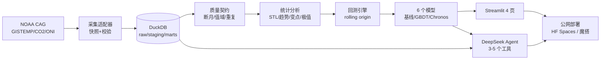

# CLMTA → ClimateScope 落地方案（适配版 v2）

> 更新：2026-10-19｜对象：数据科学与大数据技术大二｜目标：数据 + AI 方向本科就业
> 约束：**11 月底前只有约 6 周、每周 8 小时（≈48 h）**；无 GPU；DeepSeek API 预算 30 元/月；12 月要复习期末。
> 本文档是唯一方案源，看完后告诉我「确认」或「改哪里」，我再开工。

---

## 0. 一页看懂

### 0.1 你现在有什么

一份 **NOAA 官方全球陆海温度异常月度数据**（1850-01 ~ 2024-12，2100 条，无缺失无重复），外加一个 pandas「数据体检」脚本。

我验证过：`data/data.csv` 与 NOAA NCEI 官方 API 返回的 CSV **md5 完全一致**（`56b98213...`），说明数据是真的、可程序化更新；官方现在已发布到 **2026-09**，你手上这份落后约 21 个月。

### 0.2 调研结论

GitHub 同类项目分四类，中间存在明显空白：

| 类别 | 代表 | 规模 | 问题 |
| --- | --- | --- | --- |
| 同题学生项目 | `manthankapadia/...`(★4)、`SimoAntikainen/sarimax-...`(★5)、`Akajiaku11/...`(★98) | ★0–100 | 单 CSV + 线性回归/SARIMAX + 一张图，无评估、无部署、无测试 |
| 通用时序库 | darts(★9.6k)、sktime(★10.1k)、statsforecast(★4.9k)、Chronos(★6.1k)、TimesFM(★34.6k) | ★1k–35k | 只做 fit/predict，不管领域数据和解释 |
| 气候科研 benchmark | ClimateLearn(★355)、WeatherBench2(★639)、earth2studio(★1201) | ★0.3k–1.2k | 面向网格气象场，要 ERA5/CMIP + GPU，个人做不动 |
| LLM 数据分析 | Vanna(★23.8k)、DB-GPT(★20.2k)、WrenAI(★17.9k) | ★7k–24k | 架构重、通用 SQL 问答，领域深度不足 |

> star 数为 2026-10-19 快照。

**没人做的那一格**：面向「月度全球气候指标」的**可复现数据管道 + 诚实预测基准 + 能对话的分析助手 + 公网 Demo**。

### 0.3 48 小时版的结论

不追求「大而全」，只做一个**闭环完整、每个环节都能讲清楚**的项目：

```
数据自动更新 → 质量校验 → DuckDB 数仓 → 统计诊断
   → 6 个模型滚动回测（含 Chronos 零样本）→ Streamlit 可视化
   → DeepSeek 工具调用问答 → 公网部署 → README/报告/视频
```

**砍掉的**（48 h 内做不完，寒假再补）：深度学习训练（N-HiTS/PatchTST）、完整 RAG 知识库、MLflow、Evidently、MCP、K8s。
**保留的亮点**：滚动回测 + MASE/CRPS/区间覆盖率 + DM 检验、Chronos 零样本对照、DeepSeek 工具调用 + 小评测、公网 Demo。

### 0.4 六周节奏（每周 8 h）

| 周 | 日期 | 主题 | 周末必须有的东西 |
| --- | --- | --- | --- |
| 1 | 10.19–10.25 | 修地基 + 数据管道 | `make data` 一键复现 1850–2026，测试绿 |
| 2 | 10.26–11.01 | 统计分析 | STL/趋势/变点/极值 6 张核心图 + 3 条结论 |
| 3 | 11.02–11.08 | 回测框架 + 统计基线 | 回测引擎 + 4 个基线 + benchmark 表 v1 |
| 4 | 11.09–11.15 | LightGBM + Chronos | 6 模型完整对比 + 误差随 horizon 图 |
| 5 | 11.16–11.22 | Streamlit + 部署 | 公网可访问的 4 页 Demo |
| 6 | 11.23–11.29 | LLM 问答 + 包装 | 能对话的页面 + 10 题评测 + 简历/视频 |

> 12 月考试周不排任务。寒假（1–2 月）做 v2：RAG、MLflow、MCP、Docker、技术博客。

---

## 1. 现状盘点（已实际读取验证）

### 1.1 数据

| 项 | 事实 |
| --- | --- |
| 文件 | `data/data.csv`（26 KB） |
| 来源 | NOAA NCEI Climate at a Glance，`globe / land_ocean / monthly`，基准期 1901–2000 |
| 一致性 | 与官方 CSV md5 相同：`56b98213687172b413f796d5e2dcbf08` |
| 范围 | 1850-01 ~ 2024-12，2100 条；**无缺失、无重复、无断月** |
| 数值 | −0.66 ~ 1.40 °C，均值 0.057 °C |
| 十年均值 | 1850s −0.10 → 1950s −0.02 → 1990s 0.39 → 2020s 1.03 |
| 时效 | 官方已到 2026-09（1.33 °C）；本地落后 21 个月 |

### 1.2 代码与仓库问题

| 问题 | 证据 | 影响 |
| --- | --- | --- |
| README 文件名错误 | 写 `data/global-temp-time-series.csv`，实际 `data/data.csv` | 别人跑不通 |
| 列名错误 | README 写 `Anomaly`，实际 `Departure from Average` | 示例代码报错 |
| `-999` 说明失真 | 全表 0 个 −999 | 数据说明不可信 |
| 无依赖声明 | 无 `pyproject.toml` / `requirements.txt` | 不可复现 |
| 虚拟环境损坏 | `myenv/bin/` 为空 | 无法激活 |
| 嵌套 Git 仓库 | `CLMTA/CLMTA/.git` + 重复 README | 提交混乱 |
| 路径依赖 cwd | `src/run.py` 用相对路径 | 换目录即报错 |
| 无测试/CI/日志 | — | 工程信号为零 |

> 一句话：现在是「数据集 + 一个 print 脚本」，课程作业水平；但**数据本身是优质资产**，值得围绕它重建。

---

## 2. 同类项目对比（详细）

### 2.1 学生项目：题目像、工程弱

- `manthankapadia/Time-series-analysis-of-global-temperature-anomaly`（★4）：GISTEMP + 陆地/海洋数据，ARIMA 类方法。
- `SimoAntikainen/sarimax-climate-change-forecast`（★5）：SARIMAX + CO₂/ONI/太阳黑子，数据源引用规范，但只有 Notebook。
- `Ashutoshvinod-04/Global-Temp-Analysis`：GISTEMP 清洗 + 滚动平均 + 线性回归算升温速率。
- `Akajiaku11/Global-Temp-Anomaly-Analysis`（★98）：偏前端可视化。

**共同不足**：单文件 Notebook、无数据管道、无回测协议、无区间估计、无部署、无测试；结论停留在「画出趋势线」。
**可借鉴**：协变量选择（CO₂/ENSO/太阳）、数据源引用写法。

### 2.2 通用库与基础模型：当依赖，不当竞品

| 项目 | 用途 | 我们怎么用 |
| --- | --- | --- |
| `Nixtla/statsforecast` | 快速统计基线 | ETS/ARIMA 批量跑 |
| `statsmodels` | SARIMAX、STL | 主力统计模型 |
| `LightGBM` | 表格 ML | 特征工程后的强基线 |
| `amazon-science/chronos-forecasting` | 零样本时序基础模型 | **CPU 可跑 Chronos-Bolt small**，做「基础模型 vs 经典模型」对照 |
| `Nixtla/neuralforecast` | N-HiTS/PatchTST | 48 h 内不做，寒假可选 |
| `unit8co/darts` / `sktime` | 统一 API | MVP 不引入，避免封装黑盒 |

### 2.3 科研 benchmark：学评估，不学规模

- `ClimateLearn`（NeurIPS 2023 D&B）：标准化数据集 + 模型 zoo + metrics，值得学「怎么设计公平对比」。
- `WeatherBench2`：网格化中期天气预报评估，用 RMSE/ACC 等。
- `earth2studio`：NVIDIA 的推理框架，面向业务化部署。

**结论**：我们没有 TB 级网格数据，不该模仿它们的模型规模；但应模仿**评估纪律**（固定切分、基线、显著性、可复现）。

### 2.4 LLM 数据分析：学产品形态，不学架构重

`Vanna` 用 RAG 做 Text-to-SQL，`DB-GPT` 做 Agent 化数据助手，`WrenAI` 加语义层，`SQLBot` 中文生态好。
**不足**：部署重、偏通用、领域评测弱。
**我们的做法**：不做通用 Text-to-SQL，只做 **8 个气候领域只读工具 + DeepSeek function calling**，用 10–30 题评测证明可信度。

---
 
## 3. 定位与差异化

**一句话**：把「全球温度异常 CSV」做成一个**能被陌生人 10 分钟跑通、能被面试官追问 30 分钟**的气候数据 + AI 项目。

| 维度 | 学生项目 | 科研 benchmark | 通用库 | 我们 |
| --- | --- | --- | --- | --- |
| 数据管道/可复现 | ✗ | ✓（重） | ✗ | ✓ 轻量 |
| 领域深度 | 浅 | 深（网格） | 无 | ✓ 多序列 + 协变量 |
| 严谨回测 | ✗ | ✓ | 半 | ✓ rolling origin + DM |
| 不确定性 | ✗ | ✓ | 半 | ✓ 区间 + 覆盖率 |
| LLM/Agent | ✗ | ✗ | ✗ | ✓ 工具调用 + 小评测 |
| 公网 Demo | 少数 | ✗ | ✗ | ✓ |
| 工程化 | ✗ | 部分 | ✓ | ✓ 测试 + CI |

**三条面试故事**（比「准确率 99%」值钱）：
1. 用 md5 证明本地数据是 NOAA 官方快照，并设计幂等增量更新；
2. 发现「深度学习不一定赢 SARIMAX-X」，用 DM 检验说明差异是否显著；
3. Agent 在 10 题 gold set 上的工具准确率 / 引用率 / 拒答率。

---

## 4. 最终形态（48 h 版架构）



**数据流示例**：用户问「2023 年比 1950 年暖多少？」→ Agent 调 `query_range` → DuckDB → 计算差值 → 回答并标注数据来源与基准期。

---

## 5. 技术选型（48 h 版）

| 层 | 选型 | 为什么 | 不选什么 |
| --- | --- | --- | --- |
| 语言/环境 | Python 3.12 + `uv` | 快、lock 可复现 | conda（慢、重） |
| 数据处理 | pandas + **DuckDB** + Parquet | 2 万行用 DuckDB 足够；SQL 能力可写简历 | Spark/Kafka（数据量小，上了减分） |
| 统计 | statsmodels + scipy + ruptures | STL/SARIMAX/MK 检验/变点 | 自己实现 |
| ML | LightGBM | 小数据强、训练秒级 | 深度网络（无 GPU） |
| 基础模型 | **Chronos-Bolt small（CPU）** | 零样本、无需训练、2026 热点 | TimesFM 大模型（内存吃不消） |
| 回测 | 自研 ~150 行 | 面试重点，必须自己能讲 | sklearn 随机切分 |
| LLM | **DeepSeek API**（30 元/月够用） | 中文强、便宜、OpenAI 兼容 | 本地 7B（无 GPU 太慢） |
| 前端 | Streamlit + Plotly | 2 天出 Demo | Next.js（时间不够） |
| 部署 | HuggingFace Spaces / 魔搭创空间 | 免费、有公网 URL | 自建服务器 |
| 测试 | pytest + ruff + GH Actions | 最低成本工程信号 | 无 |
| 追踪 | 先 CSV/JSON 记录，寒假上 MLflow | 省时间 | 一上来就上全家桶 |

> **明确不做**：Kafka、Spark、Flink、K8s、LangChain 黑盒封装、微服务拆分。数据量 2 万行，架构要「轻」，并能解释为什么。

---

## 6. 数据方案

### 6.1 数据源（均已验证可访问）

| 数据 | 来源 | 频率/范围 | 用途 |
| --- | --- | --- | --- |
| 全球陆海异常 | NOAA CAG `globe/land_ocean` | 月，1850–2026-09 | 主目标 |
| 全球陆地/海洋 | NOAA CAG `globe/land`、`globe/ocean` | 月，1850– | 多序列 |
| 半球/纬度带 | NASA GISTEMP v4（NH/SH/ZonAnn） | 1880– | 多序列 |
| CO₂ | NOAA GML Mauna Loa | 月，1958– | 协变量 |
| ENSO | NOAA CPC ONI | 季，1950– | 协变量 |
| 太阳黑子 | SILSO | 月，1700– | 协变量（弱） |

> 全部公开数据；README 逐条注明来源、许可、访问日期。

### 6.2 表设计

```sql
series(series_id PK, name, region, area, source, units, base_period, license, retrieved_at)
observation(series_id, date, value, is_missing, flag, PK(series_id,date))
forecast_run(run_id PK, model, horizon, cutoff, params_json, git_sha, created_at)
forecast(run_id, series_id, date, yhat, lo80, hi80, lo95, hi95)
metrics(run_id, series_id, horizon, mase, rmse, mae, crps, cov80, cov95)
```

### 6.3 数据质量（要能讲出「拦住了什么」）

- 列名/类型/单位/基准期契约；日期唯一且连续；值域 `[-3, 3]`
- 断月、重复、滞后回改（官方会修订历史值）→ 快照版本 + diff 报告
- 1880 年前海洋覆盖稀疏 → 图表与结论必须标注不确定性
- 每次 ingest 生成 `data/quality_report.json`，不合格则 CI 失败

---

## 7. 建模与评估

### 7.1 任务

- 预测**月度温度异常**（不是绝对温度），horizon `h ∈ {1,3,6,12,24}`
- 序列：全球陆海 / 陆地 / 海洋 / 北半球 / 南半球
- 协变量：CO₂（水平 + 12 月差分）、ONI、太阳黑子、月份 Fourier、趋势
- **滚动 origin（walk-forward）**，≥24 个 cutoff；禁止随机切分

### 7.2 模型阶梯（48 h 内做 6 个）

| 层级 | 模型 | 作用 |
| --- | --- | --- |
| L0 | Seasonal Naive、Drift | 必须打赢的下限 |
| L1 | ETS（或 SARIMA） | 经典统计基线 |
| L2 | **SARIMAX-X**（CO₂/ENSO） | 可解释主力 |
| L3 | **LightGBM**（lag + rolling + Fourier + 协变量） | 表格 ML |
| L4 | **Chronos-Bolt 零样本** | 基础模型对照 |

> 深度模型训练（N-HiTS/PatchTST）放到寒假，无 GPU 时性价比低。

### 7.3 评估协议（项目灵魂）

- 主指标 **MASE(12)**；辅以 RMSE/MAE；区间用 **CRPS / Winkler / 覆盖率**
- 显著性：Diebold-Mariano 检验
- 分 horizon、分序列、分时段（1850–1950 / 1950–2000 / 2000–）报告
- 消融：协变量有无、lookback、训练窗长
- 泄漏检查：标准化只用训练段、特征 shift 正确、超参不在测试段选
- 产出：`reports/benchmark.md` + 3 张图（误差随 horizon、区间覆盖、DM p 值）

### 7.4 预期结论形态（诚实最重要）

> h ≤ 3：ENSO 主导，LightGBM/SARIMAX-X 领先；h ≥ 12：趋势 + CO₂ 主导，复杂模型优势消失；Chronos 零样本有竞争力但区间偏窄、覆盖率不足 → 需校准。

**如果 DL 没赢，就写「没赢」，并解释原因。这比编数字更能打动面试官。**

---

## 8. LLM 分析助手（48 h 轻量版）

### 8.1 工具（先做 3 个，够用再加）

| 工具 | 输入 | 输出 |
| --- | --- | --- |
| `query_range` | series_id, start, end | 月度序列 |
| `compute_trend` | series_id, start, end | 斜率 + CI + MK p 值 |
| `forecast` | series_id, horizon, model | 预测值 + 区间 |
| `compare_periods`（可选） | series_id, period_a, period_b | 差值 + 显著性 |
| `search_documents`（寒假） | query | 报告片段 + 引用 |

### 8.2 实现要点

- 手写 tool-calling loop（约 100 行），不用 LangChain 黑盒
- DeepSeek API：`temperature=0`、JSON Schema 校验、最多 5 步、超时与重试
- 回答必须带「数据来源 + 基准期 + 月份」；查不到就说查不到
- **缓存 LLM 响应**（30 元预算够用，但别浪费）
- 评测：10 题 gold set（事实/趋势/预测/越界），统计工具选择准确率、答案正确率、拒答率

> RAG（IPCC/NOAA 报告）放寒假做，避免 48 h 内两头不讨好。

---

## 9. 六周执行表（小时级）

### Week 1（10.19–10.25）地基 + 数据管道 — 8 h

| 时长 | 任务 | 产出 |
| --- | --- | --- |
| 2 h | 删嵌套 git、重建 venv（uv）、`pyproject.toml`、ruff、pytest | 干净环境 |
| 3 h | NOAA/GISTEMP/CO₂/ONI 下载器 + sha256 + 断月校验 + raw 快照 | `src/clmta/ingest/` |
| 2 h | DuckDB 建库、staging/marts、数据字典 | `data/clmta.duckdb` |
| 1 h | README 重写（现状/数据来源/快速开始） | 可读 README |

- **验收**：新环境执行 `make data` 能从零复现 1850–2026；`make test` 全绿。
- **要学**：DuckDB 基础 SQL（30 min/天）、pandas 读写与类型。

### Week 2（10.26–11.01）统计分析 — 8 h

| 时长 | 任务 |
| --- | --- |
| 3 h | STL 分解、年度/十年均值、月度热力图、滚动窗口 |
| 3 h | Mann-Kendall、Theil-Sen 斜率 + CI、变点检测（ruptures）、最暖/最冷 Top10 |
| 2 h | 图表统一风格，notebook 整理成 `notebooks/01_eda.ipynb` |

- **验收**：6 张核心图 + 3 条可引用结论（例：1980 年后升温速率约 X °C/十年）。
- **要学**：STL 原理、MK 检验在干嘛（不用推公式，会解释 p 值即可）。

### Week 3（11.02–11.08）回测框架 + 统计基线 — 8 h

| 时长 | 任务 |
| --- | --- |
| 3 h | `backtest/runner.py`：rolling origin、多 horizon、MASE/RMSE/CRPS/覆盖率 |
| 3 h | Seasonal Naive、Drift、ETS、SARIMAX-X（CO₂/ONI 外生变量） |
| 2 h | `reports/benchmark.md` v1 + DM 检验 |

- **验收**：同一份数据、5 个 cutoff 可复现；表里有 MASE 和覆盖率。
- **要学**：MASE 为什么比 MAPE 好；SARIMAX 外生变量含义。

### Week 4（11.09–11.15）LightGBM + Chronos — 8 h

| 时长 | 任务 |
| --- | --- |
| 2 h | 特征：lag(1,2,3,6,12)、rolling mean/std、Fourier(月份)、CO₂/ONI |
| 2 h | LightGBM 直接多步预测 + 特征重要性 |
| 2 h | Chronos-Bolt small 零样本（CPU）+ 区间输出 |
| 2 h | 汇总 6 模型、误差随 horizon 图、写结论 |

- **验收**：benchmark 完整；能回答「谁在 h=1/6/12 赢，为什么」。
- **要学**：梯度提升直觉；零样本模型在做什么。

### Week 5（11.16–11.22）Streamlit + 部署 — 8 h

| 时长 | 任务 |
| --- | --- |
| 4 h | 四页：趋势总览 / 分解与变点 / 模型对比 / 数据表 |
| 2 h | 部署到 HuggingFace Spaces 或魔搭创空间（国内访问优先魔搭） |
| 2 h | README 首屏：架构图、benchmark 表、GIF、Quickstart |

- **验收**：公网 URL 能打开、能切序列、能看预测区间。
- **要学**：Streamlit 基本组件与缓存。

### Week 6（11.23–11.29）LLM 问答 + 包装 — 8 h

| 时长 | 任务 |
| --- | --- |
| 2 h | DeepSeek function calling + 3 个工具 + 防幻觉规则 |
| 2 h | Streamlit 聊天页 + 数据来源标注 |
| 2 h | 10 题评测（缓存响应）+ 指标表 |
| 2 h | 简历 bullet、3 分钟演示视频、技术博客大纲 |

- **验收**：能问「2023 年比 1950 年暖多少」并给出正确数字、来源、基准期。
- **要学**：function calling 的消息结构；如何写一条好的 system prompt。

### 12 月：只复习，不排任务

---

## 10. 交付物、简历与面试

### 10.1 三类硬交付

1. **公网 Demo**（Streamlit 4 页 + 聊天页）
2. **可复现仓库**（README 首屏：架构图 / benchmark 表 / Quickstart / GIF / 数据来源）
3. **benchmark 报告 + 3 分钟视频 + 技术博客大纲**

### 10.2 简历 bullet 模板（数字待实测）

> **ClimateScope｜全球气候异常分析与预测平台**（个人项目，2026.10–2026.11）
> - 基于 NOAA/GISTEMP/CO₂/ENSO 构建月度气候数据管道（1850–2026，5 序列），实现幂等增量更新与 10+ 项数据契约校验，数据准备从手工 2 h 降为 1 条命令；
> - 设计 rolling-origin 回测框架，对比 6 个模型（Naive/ETS/SARIMAX-X/LightGBM/Chronos 零样本），以 MASE/CRPS/区间覆盖率评估，SARIMAX-X 在 h=12 上较基线降低 **X%**；
> - 用 DeepSeek function calling 实现气候问答助手（3 个只读工具），10 题评测集工具准确率 **X%**、拒答正确率 **Y%**；Streamlit 部署公网可访问。

### 10.3 面试 8 问（提前写答案）

1. 2100 个点为什么值得做预测？你的模型赢了吗？
2. 如何保证没有数据泄漏？
3. 为什么用 MASE 而不是 MAPE/R²？
4. 温度异常非平稳，你怎么处理趋势？
5. 预测区间怎么来？覆盖率怎么验证？
6. Chronos 零样本为什么有效？预训练数据是否覆盖测试期？
7. Agent 怎么防幻觉？评测集怎么设计？
8. 为什么不用 Kafka/Spark？

---

## 11. 风险与取舍

| 风险 | 应对 |
| --- | --- |
| 每周只有 8 h，进度掉队 | 每周只承诺「验收物」；掉队就砍 Week 6 的 LLM，保前 5 周 |
| 没 GPU | 不训练深度模型；Chronos-Bolt small 在 CPU 上跑 |
| 30 元 API 超支 | 缓存 + 限制评测次数 + 只在演示时调用 |
| 知识储备不足 | 每周 1–2 h 定向学习，我负责讲清「为什么」而不是堆代码 |
| DL 不涨点 | 诚实写结论，反而加分 |
| 过度工程 | 每个技术选择写 1 条 ADR；不上分布式组件 |
| 数据诚信 | 数据来源逐条标注；AI 辅助在 README 声明 |

### 明确不要做的三件事

1. 不抄教程改个名字（面试一问就露）；
2. 不编指标（截图和数据对不上是硬伤）；
3. 不堆技术栈（2 万行数据上 Kafka 是减分）。

---

## 12. 寒假 v2（可选，1–2 月）

- RAG：IPCC AR6 SPM + NOAA 年报 + 中国气候公报，bge-m3 + pgvector + 引用
- Agent 评测扩到 30 题；加 `search_documents`、`plot_series`
- MLOps：MLflow 实验追踪 + Docker Compose + Evidently 漂移监控
- MCP Server：让 Claude/Cursor 直接查气候数据
- N-HiTS/PatchTST（Colab 免费 GPU）
- 技术博客 + 投递暑期实习

---

## 13. 待你确认

1. 这份 48 h 版的范围是否 OK？（尤其：**Week 6 的 LLM 问答**要不要保留，还是换成更扎实的分析报告？）
2. Streamlit 部署选 **魔搭创空间**（国内快）还是 **HuggingFace Spaces**？
3. 确认后我从 Week 1 开工：先删嵌套 git、重建环境、写数据管道；每周给你一份「本周做了什么 + 你要理解的 3 个点」。

---

## 附：数据事实与链接

- 本地数据 md5：`56b98213687172b413f796d5e2dcbf08`
- NOAA CAG 全球陆海月异常：<https://www.ncei.noaa.gov/access/monitoring/climate-at-a-glance/global/time-series>
- NASA GISTEMP v4：<https://data.giss.nasa.gov/gistemp/>
- NOAA GML CO₂：<https://gml.noaa.gov/ccgg/trends/>
- NOAA CPC ONI：<https://www.cpc.ncep.noaa.gov/data/indices/oni.ascii.txt>
- SILSO：<https://www.sidc.be/SILSO/datafiles>
- ClimateLearn：<https://github.com/aditya-grover/climate-learn>
- WeatherBench2：<https://github.com/google-research/weatherbench2>
- earth2studio：<https://github.com/NVIDIA/earth2studio>
- Chronos：<https://github.com/amazon-science/chronos-forecasting>
- statsforecast：<https://github.com/Nixtla/statsforecast>
- darts：<https://github.com/unit8co/darts>
- sktime：<https://github.com/sktime/sktime>
- Vanna：<https://github.com/vanna-ai/vanna>
- DB-GPT：<https://github.com/eosphoros-ai/DB-GPT>
- WrenAI：<https://github.com/Canner/WrenAI>
