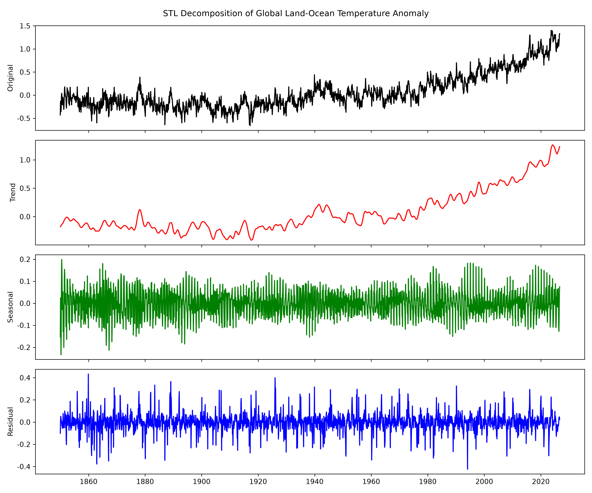
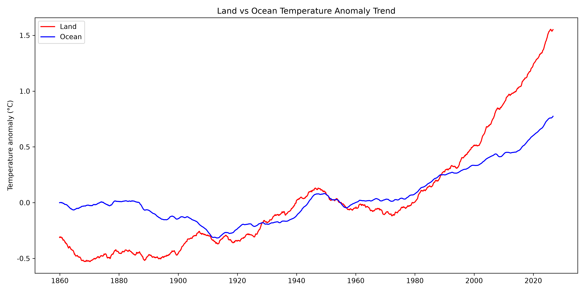
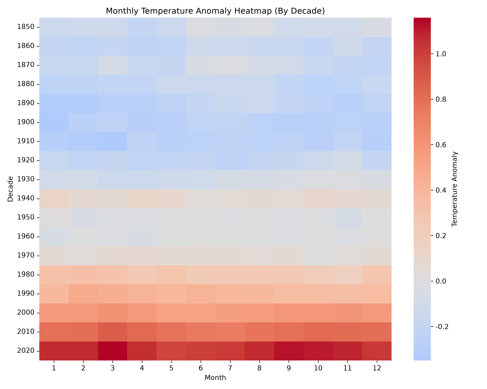
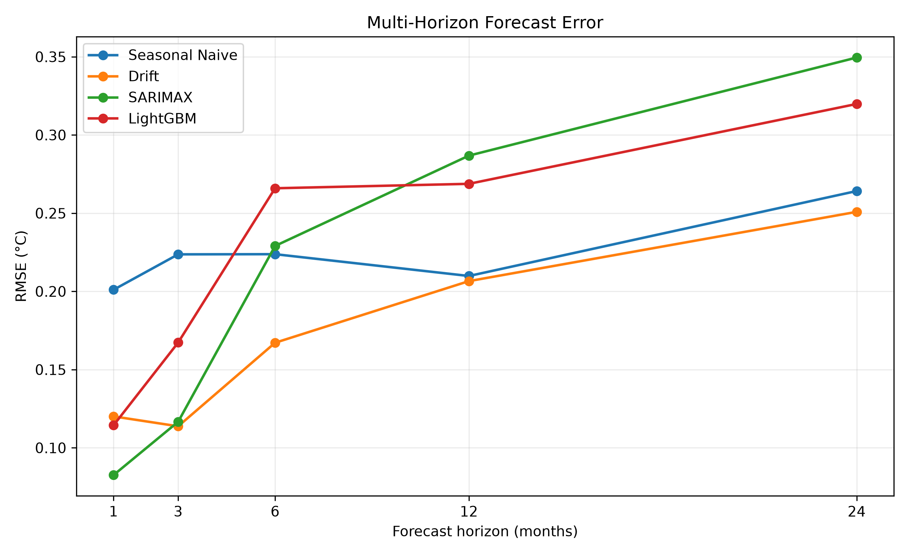
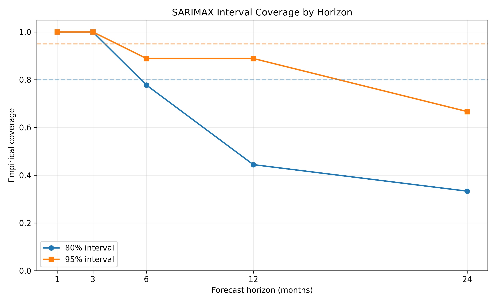

# ClimateScope (CLMTA)

ClimateScope（项目名：CLMTA）是一个面向全球月度气候异常数据的可复现分析与预测工程，聚焦全球陆地—海洋温度异常的趋势识别、突变检测、可视化和多 horizon 回测。

## 核心亮点

- 端到端数据工程：从 NOAA 官方数据源拉取原始 CSV，保留 raw 快照，并构建标准化的 `raw / staging / marts` 三层数据仓库。
- 自动化数据校验：覆盖基准期、起始月份、连续月份、数值范围、`-999`、新鲜度和防回退检查。
- 可复现分析链路：使用 pandas、DuckDB、statsmodels、scipy、ruptures 和 seaborn 形成统一分析流程，分析摘要与图表可重复生成。
- 多 horizon 回测：9 个滚动 origin，固定历史做 h=1/3/6/12/24 多步预测，对比 Seasonal Naive、Drift、SARIMAX 和 LightGBM，并按 horizon 输出 MASE、RMSE、MAE 和区间覆盖率。

## Quickstart

项目使用 Python 3.12 和 [uv](https://docs.astral.sh/uv/) 管理依赖。首次运行时，建议按顺序执行：

```bash
uv sync
make data
make db
make test
make analyze
make forecast
```

说明：

1. `uv sync`：创建并同步 Python 虚拟环境与依赖；
2. `make data`：从 NOAA 下载数据并保存原始快照；
3. `make db`：构建 DuckDB 数据仓库（raw → staging → marts）；
4. `make test`：运行 Ruff 和 pytest；
5. `make analyze`：生成 STL、趋势检验、变点、热力图和海陆对比；
6. `make forecast`：运行多 horizon 滚动回测，输出按 horizon 分类的指标、预测文件和误差/覆盖图。

也可以运行 `make pipeline` 一次完成 `data` + `db`。

## 项目文档

- [项目企划书（PDF）](docs/ClimateScope-项目企划书-v1.pdf)
- [项目企划书（Word）](docs/ClimateScope-项目企划书-v1.docx)
- [数据字典](docs/data_dictionary.md)
- [数据平台架构图](docs/architecture-data.png)

## 核心数据洞察与可视化

### 1. STL 分解与年度趋势检验：1980 年代后明显加速



STL 分解把原始温度异常拆成趋势、季节和残差三部分。趋势项在 1980 年代之后明显加速，季节项保持稳定的年度周期。

对 1850–2025 年的年度均值做 Mann-Kendall 检验：

- S = 9428.0，Z = 12.062，p < 1e-16；
- Theil-Sen 斜率 = 0.0533 °C/十年，95% CI [0.0455, 0.0610]。

这说明长期升温趋势在年度尺度上是统计显著的。这里的检验对象是**年度均值**，不是带强自相关的月度原始序列。

### 2. 海陆对比图：陆地升温速率明显快于海洋



对比 120 个月滚动平均曲线可见，陆地温度异常的上升幅度明显高于海洋，二者的差异在近几十年中持续放大。海洋热容量更大，响应更平缓；陆地升温更强。

### 3. 月度热力图：长期偏暖



月度热力图从 1850s 到 2020s 由偏冷色调逐步转为偏暖色调，说明各月份在过去一个半世纪中普遍变暖。2020s 只有 2020–2026 年，属于不完整年代，图中已标注。

### 4. 多 horizon 回测：SARIMAX 只在 h=1 最优，长期 Drift 更稳





回测口径：

- origins：2020-09 至 2024-09，每 6 个月一个，共 9 个；
- 每个 origin 只用当时可见历史，分别预测 h=1、3、6、12、24 个月；
- **窗口内不回填真实值**，同一 horizon 有 9 个 origin 样本；
- 由于 24 个月窗口互相重叠，9 个样本不是完全独立的，长期结论需要留出不确定性。

RMSE（°C）按 horizon：

| Horizon | Seasonal Naive | Drift | SARIMAX | LightGBM |
| --- | --- | --- | --- | --- |
| 1 | 0.2010 | 0.1201 | **0.0826** | 0.1144 |
| 3 | 0.2237 | **0.1138** | 0.1166 | 0.1673 |
| 6 | 0.2238 | **0.1672** | 0.2290 | 0.2659 |
| 12 | 0.2098 | **0.2066** | 0.2868 | 0.2688 |
| 24 | 0.2642 | **0.2508** | 0.3495 | 0.3198 |

MASE 按 horizon：

| Horizon | Seasonal Naive | Drift | SARIMAX | LightGBM |
| --- | --- | --- | --- | --- |
| 1 | 1.2512 | 0.8239 | **0.5654** | 0.7581 |
| 3 | 1.3506 | **0.8049** | 0.8303 | 0.9997 |
| 6 | 1.3588 | **1.1707** | 1.5636 | 1.8316 |
| 12 | **1.2105** | 1.2432 | 1.9490 | 1.8449 |
| 24 | 1.8569 | **1.7270** | 2.4595 | 2.3292 |

SARIMAX 区间覆盖：

| Horizon | 80% 覆盖率 | 80% 宽度 | 95% 覆盖率 | 95% 宽度 |
| --- | --- | --- | --- | --- |
| 1 | 1.0000 | 0.2407 | 1.0000 | 0.3680 |
| 3 | 1.0000 | 0.3633 | 1.0000 | 0.5556 |
| 6 | 0.7778 | 0.4306 | 0.8889 | 0.6585 |
| 12 | 0.4444 | 0.4661 | 0.8889 | 0.7128 |
| 24 | 0.3333 | 0.4722 | 0.6667 | 0.7222 |

结论：

- **h=1 时 SARIMAX 最优**（RMSE 0.0826，MASE 0.5654）；
- **h=3 起 Drift 的 RMSE 更低**；h=12 的 MASE 最低是 Seasonal Naive，h=24 的 MASE 最低是 Drift；
- SARIMAX 随 horizon 变长明显退化，长期预测并不占优；
- SARIMAX 区间在 h=1–3 过宽（覆盖率 100%），在 h=12–24 又过窄（80% 覆盖率仅 0.444/0.333），说明区间校准随 horizon 恶化；
- LightGBM 是**按 horizon 分别训练的直接多步模型**，不是递归预测；它的误差也随 horizon 上升。

指标和预测文件：

- `outputs/forecast_horizon_metrics.csv`
- `outputs/forecast_horizon_predictions.csv`

## 项目结构与技术栈

### 项目结构

```text
CLMTA/
├── data/
│   ├── data.csv          # 全球陆海主数据
│   ├── land.csv          # 全球陆地数据
│   ├── ocean.csv         # 全球海洋数据
│   ├── metadata.json     # 来源、sha256、行数、时间范围
│   ├── clmta.duckdb      # make db 生成的 DuckDB 数据仓库
│   ├── raw/              # NOAA 原始 CSV 快照
│   └── covariates/       # CO₂、ONI 等协变量（已下载，尚未接入模型）
├── outputs/
│   ├── figures/          # STL、热力图、海陆对比和预测图
│   ├── analysis_summary.json
│   ├── forecast_horizon_metrics.csv
│   └── forecast_horizon_predictions.csv
├── scripts/
│   ├── update_data.py    # 数据下载与校验
│   ├── build_db.py       # raw -> staging -> marts
│   ├── analyze.py        # STL、趋势、变点、热力图、海陆对比
│   ├── forecast.py       # 多 horizon 滚动回测
│   ├── queries.py        # 示例 SQL
│   └── download_covariates.py
├── tests/
│   ├── test_ingest.py
│   ├── test_db.py
│   ├── test_analysis.py
│   ├── test_forecast.py
│   └── test_smoke.py
├── docs/
│   ├── ADR-001-data-stack.md
│   ├── data_dictionary.md
│   └── architecture-data.png
├── Makefile
├── README.md
└── pyproject.toml
```

### 技术栈

- Python 3.12：核心开发语言。
- uv：依赖与环境管理。
- pandas：数据读取与清洗。
- DuckDB：本地分析型数据库，支撑 `raw / staging / marts` 三层结构。
- statsmodels：STL 分解与 SARIMAX。
- scipy：Mann-Kendall 与 Theil-Sen。
- ruptures：变点检测。
- matplotlib / seaborn：数据可视化。
- LightGBM：树模型基线。
- pytest / ruff：自动化测试与代码规范检查。

## 数据范围

- 数据来源：NOAA Climate at a Glance（CAG）
- 时间范围：1850-01 至 2026-09
- 基准期：1901-2000
- 数据单位：摄氏度（℃）
- 指标含义：月度温度异常值，相较于 1901-2000 参考期的同期平均偏差
- 主要区域：`land_ocean`、`land`、`ocean`
- 2026 年只有 1–9 月；年度统计和热力图已标注不完整年份

## Roadmap

已完成：

1. 数据管道、raw 快照、metadata 和 DuckDB 三层数仓；
2. STL、年度 Mann-Kendall、Theil-Sen、变点、热力图和海陆对比；
3. 9 个 origin × h=1/3/6/12/24 的多 horizon 预测，窗口内不回填真实值；
4. 按 horizon 输出 MASE/RMSE/MAE、SARIMAX 区间覆盖率和误差曲线。

下一阶段：

1. 接入 CO₂ / ONI 等协变量，尝试 SARIMAX-X；
2. 引入 Chronos 等基础模型作为对照；
3. Streamlit 交互式看板；
4. GitHub Actions CI 与更完整的分析/预测测试；
5. 增加更多 origin 或非重叠窗口，降低样本相关性。

## 数据来源与许可

数据来自 [NOAA Climate at a Glance](https://www.ncei.noaa.gov/access/monitoring/climate-at-a-glance/global/time-series)。使用或再发布数据时，请保留 NOAA 的来源说明，并以官方页面为准。

代码和项目文档的许可信息仍在完善中，欢迎通过 Issue 或 Pull Request 交流问题和改进建议。
