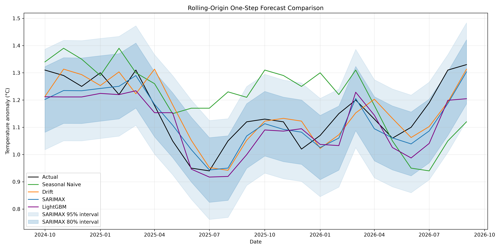

# ClimateScope (CLMTA)

ClimateScope（项目名：CLMTA）是一个面向全球月度气候异常数据的可复现分析与预测工程，聚焦全球陆地—海洋温度异常的趋势识别、突变检测、可视化和一步预测回测。

## 核心亮点

- 端到端数据工程：从 NOAA 官方数据源拉取原始 CSV，保留 raw 快照，并构建标准化的 `raw / staging / marts` 三层数据仓库。
- 自动化数据校验：覆盖基准期、起始月份、连续月份、数值范围、`-999`、新鲜度和防回退检查。
- 可复现分析链路：使用 pandas、DuckDB、statsmodels、scipy、ruptures 和 seaborn 形成统一分析流程，分析摘要与图表可重复生成。
- 一步预测回测：24 个逐月滚动起点，对比 Seasonal Naive、Drift、SARIMAX 和 LightGBM，并输出 MASE、RMSE、MAE、区间覆盖率和 DM 检验。

## Quickstart

项目使用 Python 3.12 和 [uv](https://docs.astral.sh/uv/) 管理依赖。首次运行时，建议按顺序执行：

```bash
uv sync
make data
make db
make test
make analyze
make forecast
```

说明：

1. `uv sync`：创建并同步 Python 虚拟环境与依赖；
2. `make data`：从 NOAA 下载数据并保存原始快照；
3. `make db`：构建 DuckDB 数据仓库（raw → staging → marts）；
4. `make test`：运行 Ruff 和 pytest；
5. `make analyze`：生成 STL、趋势检验、变点、热力图和海陆对比；
6. `make forecast`：运行一步滚动回测，输出指标、预测文件和对比图。

也可以运行 `make pipeline` 一次完成 `data` + `db`。

## 项目文档

- [项目企划书（PDF）](docs/ClimateScope-项目企划书-v1.pdf)
- [项目企划书（Word）](docs/ClimateScope-项目企划书-v1.docx)
- [数据字典](docs/data_dictionary.md)
- [数据平台架构图](docs/architecture-data.png)

## 核心数据洞察与可视化

### 1. STL 分解与年度趋势检验：1980 年代后明显加速


STL 分解把原始温度异常拆成趋势、季节和残差三部分。趋势项在 1980 年代之后明显加速，季节项保持稳定的年度周期。

对 1850–2025 年的年度均值做 Mann-Kendall 检验：

- S = 9428.0，Z = 12.062，p < 1e-16；
- Theil-Sen 斜率 = 0.0533 °C/十年，95% CI [0.0455, 0.0610]。

这说明长期升温趋势在年度尺度上是统计显著的。这里的检验对象是**年度均值**，不是带强自相关的月度原始序列。

### 2. 海陆对比图：陆地升温速率明显快于海洋


对比 120 个月滚动平均曲线可见，陆地温度异常的上升幅度明显高于海洋，二者的差异在近几十年中持续放大。海洋热容量更大，响应更平缓；陆地升温更强。

### 3. 月度热力图：长期偏暖


月度热力图从 1850s 到 2020s 由偏冷色调逐步转为偏暖色调，说明各月份在过去一个半世纪中普遍变暖。2020s 只有 2020–2026 年，属于不完整年代，图中已标注。

### 4. 一步滚动回测：SARIMAX 点预测最优，区间偏保守



回测口径：训练集 2000-01 至 2024-09（297 个月），测试集 2024-10 至 2026-09（24 个月）。每个测试月只用当时可见历史预测下一个月，共 **24 个一步预测**，不是 24 步长期预测。

| 模型 | MASE | RMSE | MAE | 80% 覆盖率 | 80% 区间宽度 | 95% 覆盖率 | 95% 区间宽度 |
| --- | --- | --- | --- | --- | --- | --- | --- |
| Seasonal Naive | 1.0321 | 0.1570 | 0.1350 | — | — | — | — |
| Drift | 0.5214 | 0.0779 | 0.0682 | — | — | — | — |
| **SARIMAX** | **0.3723** | **0.0601** | **0.0487** | 0.9583 | 0.2372 | 1.0000 | 0.3628 |
| LightGBM | 0.5251 | 0.0818 | 0.0687 | — | — | — | — |

DM 检验（负值表示 SARIMAX 的平方误差更小）：

| 对比基线 | DM 统计量 | p 值 |
| --- | --- | --- |
| Seasonal Naive | −4.8433 | < 0.001 |
| Drift | −2.2988 | 0.0215 |
| LightGBM | −3.0174 | 0.0025 |

需要说明：

- SARIMAX 在一步预测的 MASE/RMSE/MAE 上最低，DM 检验也支持差异显著；
- SARIMAX 的 80% 区间实际覆盖 95.8%，95% 区间覆盖 100%，说明区间偏保守、偏宽；
- 只有 SARIMAX 输出了预测区间，因此这里展示的是区间校准情况，不是“区间覆盖优于其他模型”；
- LightGBM 也是一步预测，使用真实历史特征，不是递归多步，因此不应把它的平滑表现归因于“递归误差累积”。

指标和预测文件：

- `outputs/forecast_metrics.csv`
- `outputs/forecast_predictions.csv`
- `outputs/forecast_dm_tests.csv`

## 项目结构与技术栈

### 项目结构

```text
CLMTA/
├── data/
│   ├── data.csv          # 全球陆海主数据
│   ├── land.csv          # 全球陆地数据
│   ├── ocean.csv         # 全球海洋数据
│   ├── metadata.json     # 来源、sha256、行数、时间范围
│   ├── clmta.duckdb      # make db 生成的 DuckDB 数据仓库
│   ├── raw/              # NOAA 原始 CSV 快照
│   └── covariates/       # CO₂、ONI 等协变量（已下载，尚未接入模型）
├── outputs/
│   ├── figures/          # STL、热力图、海陆对比和预测图
│   ├── analysis_summary.json
│   ├── forecast_metrics.csv
│   ├── forecast_predictions.csv
│   └── forecast_dm_tests.csv
├── scripts/
│   ├── update_data.py    # 数据下载与校验
│   ├── build_db.py       # raw -> staging -> marts
│   ├── analyze.py        # STL、趋势、变点、热力图、海陆对比
│   ├── forecast.py       # 一步滚动回测
│   ├── queries.py        # 示例 SQL
│   └── download_covariates.py
├── tests/
│   ├── test_ingest.py
│   ├── test_db.py
│   ├── test_analysis.py
│   ├── test_forecast.py
│   └── test_smoke.py
├── docs/
│   ├── ADR-001-data-stack.md
│   ├── data_dictionary.md
│   └── architecture-data.png
├── Makefile
├── README.md
├── PLAN.md
└── pyproject.toml
```

### 技术栈

- Python 3.12：核心开发语言。
- uv：依赖与环境管理。
- pandas：数据读取与清洗。
- DuckDB：本地分析型数据库，支撑 `raw / staging / marts` 三层结构。
- statsmodels：STL 分解与 SARIMAX。
- scipy：Mann-Kendall、Theil-Sen 与 DM 检验。
- ruptures：变点检测。
- matplotlib / seaborn：数据可视化。
- LightGBM：树模型基线。
- pytest / ruff：自动化测试与代码规范检查。

## 数据范围

- 数据来源：NOAA Climate at a Glance（CAG）
- 时间范围：1850-01 至 2026-09
- 基准期：1901-2000
- 数据单位：摄氏度（℃）
- 指标含义：月度温度异常值，相较于 1901-2000 参考期的同期平均偏差
- 主要区域：`land_ocean`、`land`、`ocean`
- 2026 年只有 1–9 月；年度统计和热力图已标注不完整年份

## Roadmap

已完成：

1. 数据管道、raw 快照、metadata 和 DuckDB 三层数仓；
2. STL、年度 Mann-Kendall、Theil-Sen、变点、热力图和海陆对比；
3. 24 个一步滚动预测，SARIMAX / Drift / Seasonal Naive / LightGBM 对比；
4. 区间覆盖率、DM 检验、指标和预测文件落盘。

下一阶段：

1. 真正的多 horizon 回测：h=1、3、6、12、24，按 horizon 报告误差与覆盖率；
2. 接入 CO₂ / ONI 等协变量，尝试 SARIMAX-X；
3. 引入 Chronos 等基础模型作为对照；
4. Streamlit 交互式看板；
5. GitHub Actions CI 与更完整的分析/预测测试。

## 数据来源与许可

数据来自 [NOAA Climate at a Glance](https://www.ncei.noaa.gov/access/monitoring/climate-at-a-glance/global/time-series)。使用或再发布数据时，请保留 NOAA 的来源说明，并以官方页面为准。

代码和项目文档的许可信息仍在完善中，欢迎通过 Issue 或 Pull Request 交流问题和改进建议。
