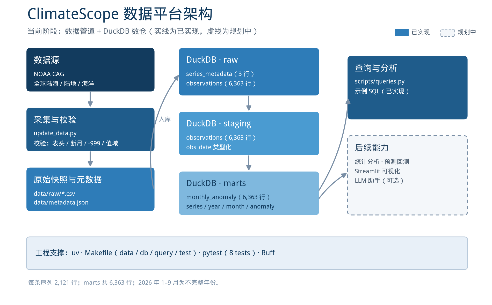

# ClimateScope 项目企划书

> 全球陆地—海洋月度温度异常的可复现数据平台
> 版本 v1.0｜2026-10-24｜当前阶段：数据管道与数仓已完成

## 0. 摘要

ClimateScope（项目代号 CLMTA）是一个面向月度全球气候指标的数据平台。项目以 NOAA 公开的全球陆地—海洋温度异常数据为基础，先建设可复现的数据管道和 DuckDB 数仓，再逐步加入统计分析、预测回测、可视化与可选的对话式查询能力。

当前阶段已经完成：

- 三条月度序列的自动获取、校验、原始快照和元数据记录；
- DuckDB `raw → staging → marts` 三层数仓；
- 数据字典、示例 SQL 和 8 个自动化测试；
- `make data`、`make db`、`make query`、`make test` 四个可复现命令。

后续阶段将围绕“先理解数据、再评估模型、最后做展示”的顺序推进。项目不会在数据和分析结果尚未验证时预先给出模型指标。

## 1. 项目背景

### 1.1 研究对象

项目研究的核心指标是**全球陆地—海洋平均温度异常**（temperature anomaly）：某个月的平均气温相对于 1901–2000 年同期平均值的偏差，单位为 °C。

例如，`202609, 1.33` 表示 2026 年 9 月全球陆地与海洋的平均气温比 1901–2000 年 9 月平均高 1.33 °C。

### 1.2 为什么做这个项目

- 数据时间跨度长：1850-01 至 2026-09，共 2,121 个月，适合练习趋势、季节性、变点和极值分析；
- 数据公开可获取：NOAA NCEI Climate at a Glance 提供稳定的 CSV 接口；
- 数据可验证：原始快照、sha256、行数、时间范围和基准期都可以记录；
- 结构清晰：三条序列（全球陆海、陆地、海洋）可以支撑对比分析，也为后续加入半球和纬度带留出空间。

### 1.3 数据特点与挑战

| 特点 | 对项目的影响 |
| --- | --- |
| 温度异常有正有负 | 负值表示比基准期更冷，不是绝对温度，也不是“零下” |
| 早期海洋观测稀疏 | 1880 年以前不确定性更大，图表和结论需要标注 |
| 2026 年只有 1–9 月 | 年度对比时必须排除不完整年份 |
| 官方会修订历史值 | 需要保留原始快照和每次更新的元数据 |
| 全球均值掩盖区域差异 | 后续需要补充陆地/海洋、半球和纬度带序列 |

## 2. 项目目标与范围

### 2.1 总体目标

建设一个**可复现、可追溯、可扩展**的月度气候数据平台：

1. 一条命令更新数据，一条命令重建数仓；
2. 每个数据文件都有来源、哈希和时间范围；
3. 数据质量问题在入库前被拦截；
4. 后续分析和预测都基于同一份可信数据。

### 2.2 分阶段目标

| 阶段 | 内容 | 状态 |
| --- | --- | --- |
| 1. 数据管道 + 数仓 | 数据获取、校验、raw 快照、metadata、DuckDB 三层 | 已完成 |
| 2. 统计分析 | STL、趋势检验、变点、极值、海陆对比 | 规划中 |
| 3. 预测基准 | 滚动回测、候选模型、误差与区间评估 | 规划中 |
| 4. 可视化 | Streamlit 数据概览、趋势、模型对比、查询 | 规划中 |
| 5. 对话式查询 | 只读工具调用、数据来源标注、评测 | 可选 |

### 2.3 当前范围（In scope）

- 三条 NOAA 月度序列：`land_ocean`、`land`、`ocean`；
- 1850-01 至最新可用月份；
- 数据校验、原始快照、元数据、DuckDB 数仓；
- 数据字典、示例查询、自动化测试；
- 为统计分析和预测预留接口。

### 2.4 明确不做（Out of scope）

- 不做绝对气温重建或气候模式模拟；
- 不做网格化气象场、区域降尺度或 CMIP 数据处理；
- 不把全球均值结论直接用于气候政策判断；
- 当前阶段不引入 Spark、Kafka、Flink、K8s 等分布式组件；
- 当前阶段不训练深度学习模型，先完成统计分析和可解释基线。

## 3. 数据资产

### 3.1 数据来源

| 序列 | 来源 | 频率 / 范围 | 用途 |
| --- | --- | --- | --- |
| `land_ocean` | NOAA NCEI Climate at a Glance | 月，1850–2026-09 | 主序列 |
| `land` | NOAA NCEI Climate at a Glance | 月，1850–2026-09 | 陆地对比 |
| `ocean` | NOAA NCEI Climate at a Glance | 月，1850–2026-09 | 海洋对比 |

- 基准期：1901–2000
- 单位：°C
- 数据许可：美国政府作品，公有领域，使用时需注明 NOAA 来源
- 官方入口：[NOAA Climate at a Glance](https://www.ncei.noaa.gov/access/monitoring/climate-at-a-glance/global/time-series)

### 3.2 关键数据事实

以下统计均针对全球陆海主序列（`land_ocean`）。

| 项目 | 数值 |
| --- | --- |
| 时间范围 | 1850-01 ~ 2026-09 |
| 每条序列记录数 | 2,121 |
| 三条序列总记录数 | 6,363 |
| 数值范围 | −0.66 ~ 1.40 °C |
| 2025 年均值 | 1.12 °C |
| 2026 年 1–9 月均值 | 1.17 °C |
| 最新月份（2026-09） | 1.33 °C |
| 有记录以来最暖月份 | 2023-09（1.40 °C） |
| 1970–2026 线性趋势 | 约 +0.196 °C / 十年 |
| 2020–2026 年均值 | 1.06 °C |

### 3.3 数据文件与元数据

| 文件 | 说明 |
| --- | --- |
| `data/data.csv` | 全球陆海主序列（`Date, Anomaly`） |
| `data/land.csv` | 全球陆地序列 |
| `data/ocean.csv` | 全球海洋序列 |
| `data/metadata.json` | 每条序列的 sha256、行数、时间范围、来源 URL、原始文件名 |
| `data/raw/` | NOAA 原始快照，只增不删 |

### 3.4 使用注意

- 温度异常不是绝对温度；
- 1880 年以前海洋覆盖稀疏，早期结果需要更谨慎；
- 2026 年只有 9 个月，年度排名应排除；
- NOAA 可能回改历史值，因此保留 raw 快照和 metadata；
- 全球均值不能替代区域分析。

## 4. 系统架构



### 4.1 分层说明

| 层 | 组件 | 产出 |
| --- | --- | --- |
| 数据源 | NOAA CAG（三条序列） | 原始 CSV |
| 采集与校验 | `scripts/update_data.py` | raw 快照、`metadata.json`、标准 CSV |
| 数仓 | DuckDB `raw / staging / marts` | 可查询的分层数据 |
| 查询与分析 | `scripts/queries.py`、后续分析模块 | SQL 结果、图表、报告 |
| 应用 | Streamlit、可选的 LLM 助手 | 交互式页面、对话式查询 |

### 4.2 数据流

```text
NOAA CAG
  → update_data.py（下载 / 校验 / 快照 / metadata）
  → data/raw/*.csv + data/metadata.json
  → DuckDB raw.observations + raw.series_metadata
  → staging.observations（生成 obs_date）
  → marts.monthly_anomaly（补充 year / month）
  → queries.py / 后续分析 / 可视化
```

### 4.3 工程支撑

- `uv`：环境与依赖管理；
- `Makefile`：`data` / `db` / `query` / `test` / `pipeline`；
- `pytest`：8 个测试，覆盖数据解析、错误分支、数仓构建；
- `Ruff`：代码规范检查；
- `DuckDB`：单文件数仓，无需额外服务。

## 5. 数据仓库设计

### 5.1 分层与表

| 层 | 表 | 粒度 | 行数 | 说明 |
| --- | --- | --- | --- | --- |
| raw | `raw.series_metadata` | 每条序列一行 | 3 | 来源、sha256、行数、时间范围、原始文件名 |
| raw | `raw.observations` | 序列 × 月 | 6,363 | 直接读取原始 NOAA 快照 |
| staging | `staging.observations` | 序列 × 月 | 6,363 | 生成 `obs_date`，统一类型 |
| marts | `marts.monthly_anomaly` | 序列 × 月 | 6,363 | 分析主表，含 `year`、`month`、`anomaly` |

### 5.2 字段摘要

| 表 | 关键字段 |
| --- | --- |
| `raw.series_metadata` | `series`、`sha256`、`row_count`、`first_month`、`last_month`、`base_period`、`source_url`、`raw_file` |
| `raw.observations` | `series`、`date_int`（YYYYMM）、`anomaly`、`source_file` |
| `staging.observations` | `series`、`date_int`、`obs_date`（DATE）、`anomaly`、`source_file` |
| `marts.monthly_anomaly` | `series`、`date_int`、`obs_date`、`year`、`month`、`anomaly` |

完整字段类型和说明见 `docs/data_dictionary.md`。

### 5.3 数据质量规则

入库前检查：

- 基准期是否为 1901–2000；
- 按固定列名解析 CSV，并统一为 `Date` / `Anomaly`；
- 日期是否为 `YYYYMM`，月份是否合法；
- 行数是否足够，起始月份是否为 1850-01；
- 数值能否转成浮点数，是否落在合理范围；
- 是否混入 `-999`；
- 是否断月、重复、倒序；
- 数据是否过旧；
- 新数据是否比旧数据更旧（防回退）。

数仓构建后检查：

- `raw` / `staging` / `marts` 三层行数一致；
- 每条序列行数与 metadata 一致；
- `obs_date`、`anomaly` 无空值；
- 起止月份与 metadata 一致；
- 构建失败自动回滚。

### 5.4 示例查询

```sql
-- 最近 3 个月全球陆海温度异常
SELECT date_int, anomaly
FROM marts.monthly_anomaly
WHERE series = 'land_ocean'
ORDER BY obs_date DESC
LIMIT 3;

-- 最热年份 Top 5（只统计 12 个月的完整年份）
SELECT year, ROUND(AVG(anomaly), 2) AS avg_anomaly
FROM marts.monthly_anomaly
WHERE series = 'land_ocean'
GROUP BY year
HAVING COUNT(*) = 12
ORDER BY avg_anomaly DESC
LIMIT 5;

-- 2015–2024 年陆地 vs 海洋
SELECT series, ROUND(AVG(anomaly), 2) AS avg_anomaly
FROM marts.monthly_anomaly
WHERE year BETWEEN 2015 AND 2024
  AND series IN ('land', 'ocean')
GROUP BY series
ORDER BY series;
```

## 6. 技术选型

| 层 | 当前 | 后续规划 | 理由 |
| --- | --- | --- | --- |
| 语言 / 环境 | Python 3.12 + uv | 保持 | 依赖可复现，环境启动快 |
| 数据获取 | requests | 保持 | 接口简单，标准 CSV |
| 数据处理 | pandas | pandas + DuckDB | 小数据足够，SQL 便于分析 |
| 数仓 | DuckDB | 保持 | 单文件、零运维、列式查询 |
| 统计 | — | statsmodels、scipy、ruptures | STL、趋势检验、变点 |
| 机器学习 | — | LightGBM | 小数据上训练快、可解释 |
| 基础模型 | — | Chronos-Bolt（零样本） | CPU 可跑，作为对照 |
| 可视化 | — | Streamlit + Plotly | 快速构建交互页面 |
| 测试 / 规范 | pytest、Ruff | 保持 | 最低成本的工程保障 |

### 6.1 选型原则

- 数据量小，优先单机方案；
- 先保证可复现，再追求复杂度；
- 统计基线优先于复杂模型；
- 每个技术选择都要能解释“为什么不用更重的方案”。

### 6.2 明确不引入

- Kafka、Spark、Flink、K8s；
- 微服务和多数据库拆分；
- 当前阶段的深度学习训练；
- 未经验证的大模型微调。

## 7. 工程实现与复现

### 7.1 目录结构

```text
CLMTA/
├── data/
│   ├── data.csv / land.csv / ocean.csv
│   ├── metadata.json
│   ├── clmta.duckdb
│   └── raw/
├── docs/
│   ├── data_dictionary.md
│   ├── architecture-data.png
│   └── 项目企划书
├── scripts/
│   ├── update_data.py
│   ├── build_db.py
│   └── queries.py
├── src/
├── tests/
├── Makefile
├── README.md
└── pyproject.toml
```

### 7.2 常用命令

| 命令 | 作用 |
| --- | --- |
| `uv sync` | 同步依赖和环境 |
| `make data` | 从 NOAA 更新数据、raw 快照和 metadata |
| `make db` | 重建 DuckDB `raw → staging → marts` |
| `make query` | 运行示例 SQL |
| `make test` | Ruff + pytest |
| `make pipeline` | `make data` + `make db` |

### 7.3 测试与质量

当前测试覆盖：

- 正常数据通过校验；
- 断月数据报错；
- `-999` 数据报错；
- 数仓三层行数、序列数、空值、起止月份；
- 项目基本文件和依赖导入。

当前结果：**8 个测试全部通过，Ruff 无错误。**

## 8. 分析与建模规划

### 8.1 统计分析

- STL 分解：趋势、季节、残差；
- 年度、十年、滚动 12 月均值；
- Mann-Kendall 趋势检验；
- Theil-Sen 斜率与置信区间；
- 变点检测：定位升温加速年份；
- 极值分析：最暖/最冷月份、连续暖月；
- 海陆对比、季节差异。

### 8.2 预测基准

任务：预测月度温度异常，horizon 取 1、3、6、12、24 个月。

候选模型：

- Seasonal Naive、Drift；
- ETS / SARIMA；
- SARIMAX-X（CO₂、ENSO 等协变量）；
- LightGBM（lag、rolling、Fourier、协变量）；
- Chronos-Bolt 零样本（对照）。

评估协议：

- 滚动 origin（walk-forward），禁止随机切分；
- 主指标 MASE(12)，辅助 RMSE、MAE；
- 区间指标 CRPS、Winkler、覆盖率；
- Diebold-Mariano 检验；
- 分 horizon、分序列、分时段报告；
- 检查数据泄漏：标准化、特征 shift、超参选择。

当前阶段尚未产生任何模型指标；后续结果会写入单独的 benchmark 报告。

### 8.3 年度口径

2026 年只有 1–9 月。年度排名和年度均值必须使用完整年份：

```sql
GROUP BY year
HAVING COUNT(*) = 12
```

或者在分析前显式过滤 `year <= 2025`。

## 9. 可视化与交互规划

### 9.1 Streamlit 页面

- 数据概览：最新月份、年度均值、序列对比；
- 趋势与分解：STL、滚动均值、变点；
- 模型对比：不同 horizon 的误差与区间；
- 数据表：按序列和年份筛选，支持下载。

### 9.2 对话式查询（可选）

在数据和分析接口稳定后，可以增加只读工具调用：

- 查询指定序列和时间范围；
- 计算趋势、对比两个时期；
- 调用预测结果；
- 回答必须带数据来源和基准期；
- 用固定问题集评估工具调用和拒答行为。

该能力为可选项，不影响当前数据管道和数仓的交付。

## 10. 里程碑与交付物

| 阶段 | 完成标准 | 状态 |
| --- | --- | --- |
| 1. 数据管道 + 数仓 | `make data` / `make db` 可复现；三层行数一致；8 tests 通过 | 已完成 |
| 2. 统计分析 | 6 张核心图 + 3 条可引用结论 | 规划中 |
| 3. 预测基准 | 滚动回测 + 多模型对比 + 误差/区间报告 | 规划中 |
| 4. 可视化 | Streamlit 四页 + 本地运行 | 规划中 |
| 5. 对话式查询 | 只读工具 + 小规模评测 | 可选 |

### 10.1 交付物

- 可复现的数据管道和 DuckDB 数仓；
- 数据字典和 README；
- 示例 SQL 与自动化测试；
- 后续的统计分析报告、预测 benchmark、可视化页面。

## 11. 风险与应对

| 风险 | 应对 |
| --- | --- |
| NOAA 修订历史数据 | 保留 raw 快照、metadata、sha256；构建前做防回退校验 |
| 早期观测稀疏 | 图表和结论标注 1880 年前的不确定性 |
| 2026 年数据不完整 | 年度统计使用 `HAVING COUNT(*) = 12` |
| 网络或接口不可用 | 下载失败时中止，不覆盖旧数据；保留上一次快照 |
| 范围膨胀 | 按阶段推进；当前阶段不引入分布式组件和深度模型 |
| 生成物与源码不一致 | `make db` 可重复构建；数据字典记录表结构 |
| 数据库文件较大 | 单文件 DuckDB，必要时可通过 `make db` 重建 |

## 12. 验收标准

### 12.1 当前阶段

- `make data` 能更新三条序列、raw 快照和 metadata；
- `make db` 能构建 `raw` / `staging` / `marts`，三层各 6,363 行；
- `make query` 能返回最近月份、完整年份 Top 5、2015–2024 海陆对比；
- `make test` 通过 Ruff 和 8 个 pytest 用例；
- 数据字典和 README 与代码一致。

### 12.2 后续阶段

- 统计分析报告包含方法、图表和限制说明；
- 预测报告包含滚动回测、基线对比、区间覆盖率和显著性检验；
- 可视化页面能按序列和时间范围交互；
- 所有结论都能追溯到数据版本和 SQL/代码。

## 附录 A：数据字典摘要

完整数据字典见 `docs/data_dictionary.md`。

| 表 | 主要字段 |
| --- | --- |
| `raw.series_metadata` | series、sha256、row_count、first_month、last_month、base_period、source_url、raw_file |
| `raw.observations` | series、date_int、anomaly、source_file |
| `staging.observations` | series、date_int、obs_date、anomaly、source_file |
| `marts.monthly_anomaly` | series、date_int、obs_date、year、month、anomaly |

## 附录 B：术语表

- **温度异常 / 距平**：相对基准期的偏差，不是绝对温度。
- **基准期**：本项目为 1901–2000 年。
- **raw / staging / marts**：原始层、类型化层、分析层。
- **MASE**：平均绝对误差除以季节性朴素基线的平均绝对误差。
- **CRPS**：连续排名概率得分，评估概率预测。
- **rolling origin**：滚动起点回测，避免未来信息泄漏。
- **DM 检验**：Diebold-Mariano 检验，比较两个模型误差差异是否显著。
